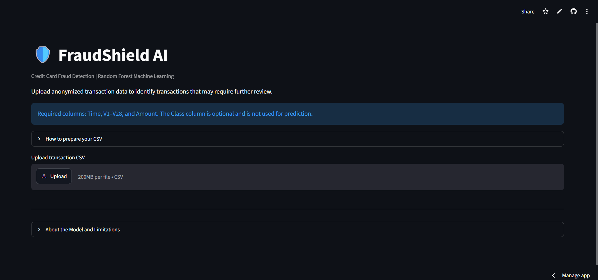
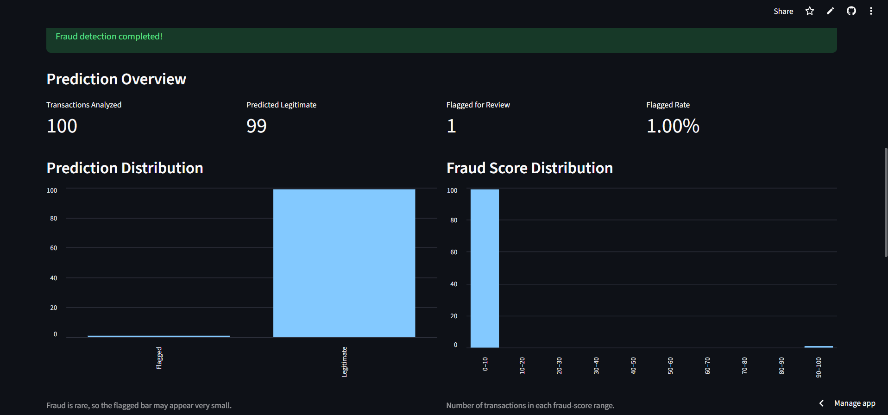
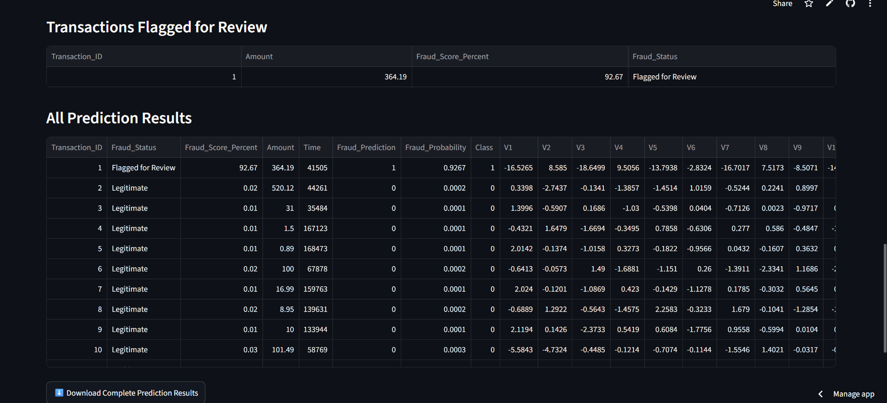

# 🛡️ FraudShield AI

### End-to-End Credit Card Fraud Detection Using Machine Learning

**[🚀 Try the Live Application](https://fraudshield-ai-8np7pq5scmxyba6qme4def.streamlit.app/)**

FraudShield AI is an end-to-end machine learning project that detects potentially fraudulent credit card transactions using a **Random Forest classifier**.

The project demonstrates the complete machine learning workflow, from data exploration and model development to evaluation, deployment, and application testing.

**Tech Stack:** Python · Pandas · NumPy · Scikit-learn · Matplotlib · Seaborn · Streamlit · Joblib · Google Colab

---

## 1. Project Overview

Credit card fraud detection is a challenging classification problem because fraudulent transactions account for only a small fraction of total transactions.

A model that predicts every transaction as legitimate can achieve very high accuracy while failing to detect fraud.

FraudShield AI focuses on identifying suspicious transactions while balancing two important objectives:

- **Detecting fraud:** Identifying as many actual fraudulent transactions as possible.
- **Reducing false alarms:** Avoiding unnecessary flags on legitimate transactions.

### Project Workflow

1. Dataset understanding and exploratory data analysis
2. Data preprocessing and stratified splitting
3. Logistic Regression baseline development
4. Class imbalance handling and threshold tuning
5. Random Forest training and model comparison
6. Cross-validation and feature importance analysis
7. Final evaluation on unseen test data
8. Model serialization using Joblib
9. Streamlit application development and deployment
10. Input validation and application testing

---

## 2. Dataset

**Source:** [Credit Card Fraud Detection Dataset — Kaggle](https://www.kaggle.com/datasets/mlg-ulb/creditcardfraud)

The dataset contains anonymized credit card transactions made by European cardholders in September 2013.

| Property | Value |
|---|---:|
| Total Transactions | 284,807 |
| Legitimate Transactions | 284,315 |
| Fraudulent Transactions | 492 |
| Fraud Percentage | 0.173% |
| Input Features | 30 |
| Target Column | `Class` |
| Missing Values | 0 |

### Feature Description

| Feature | Description |
|---|---|
| `Time` | Seconds elapsed since the first recorded transaction |
| `Amount` | Transaction amount |
| `V1`–`V28` | Anonymized numerical features obtained through PCA |
| `Class` | Target label: 0 = legitimate, 1 = fraud |

The original meanings of `V1`–`V28` are unavailable because the dataset has been anonymized.

### Class Imbalance

Only approximately **0.173%** of transactions are fraudulent.

This means accuracy alone is not a reliable indicator of fraud detection performance.

The project therefore emphasizes:

- **Precision:** Proportion of flagged transactions that are actually fraudulent.
- **Recall:** Proportion of actual fraudulent transactions correctly detected.
- **F1-score:** Harmonic mean of precision and recall.
- **Average Precision:** Summary of performance across the precision–recall curve.

---

## 3. Exploratory Data Analysis

Exploratory Data Analysis was performed to understand the dataset before training machine learning models.

### Analyses Performed

- Legitimate versus fraudulent transaction distribution
- Transaction amount distributions
- Transaction timing patterns
- Feature correlation analysis
- Relationships between numerical features and fraud labels

### Key Findings

**Severe class imbalance:** Fraudulent transactions represent less than 0.2% of the dataset.

**Transaction amount:** Legitimate and fraudulent transactions have overlapping amount distributions, meaning amount alone cannot reliably identify fraud.

**Transaction timing:** Timing patterns may contain useful information but are not sufficient for fraud detection on their own.

**Feature correlations:** Some anonymized PCA features show stronger associations with the fraud label.

| Feature | Correlation with Fraud |
|---|---:|
| V17 | -0.3265 |
| V14 | -0.3025 |
| V12 | -0.2606 |
| V10 | -0.2169 |
| V16 | -0.1965 |

These correlations indicate statistical relationships, not causal explanations.

---

## 4. Data Preprocessing

### Train–Validation–Test Split

The dataset was divided using stratified sampling to preserve the fraud proportion across subsets.

| Dataset | Percentage | Transactions |
|---|---:|---:|
| Training | 70% | 199,364 |
| Validation | 15% | 42,721 |
| Testing | 15% | 42,722 |

- **Training set:** Used to train models.
- **Validation set:** Used for model comparison and threshold selection.
- **Test set:** Reserved for final evaluation.

### Feature Scaling

`StandardScaler` was applied to:

- `Time`
- `Amount`

The PCA-transformed features `V1`–`V28` were passed through without additional scaling.

Preprocessing was implemented using scikit-learn's `ColumnTransformer` and `Pipeline` to ensure consistent transformations and help prevent data leakage.

---

## 5. Model Development and Comparison

Three classification approaches were evaluated.

### Logistic Regression — Baseline

Logistic Regression was used as the baseline model because it is computationally efficient and provides a useful reference for comparing more complex approaches.

**Validation Results (Threshold = 0.50)**

| Metric | Score |
|---|---:|
| Precision | 88.00% |
| Recall | 59.46% |
| F1-score | 70.97% |
| Average Precision | 77.05% |

The baseline achieved relatively high precision but missed a substantial number of fraudulent transactions.

### Class-Weighted Logistic Regression

To address class imbalance, Logistic Regression was trained using `class_weight="balanced"`.

**Validation Results**

| Metric | Score |
|---|---:|
| Precision | 6.81% |
| Recall | 91.89% |
| F1-score | 12.69% |
| Average Precision | 75.20% |

Although recall improved, the model generated many false positives.

This highlighted the importance of balancing fraud detection with false-alarm reduction.

### Random Forest Classifier

Random Forest was evaluated to capture nonlinear relationships and interactions among transaction features.

**Validation Results (Threshold = 0.50)**

| Metric | Score |
|---|---:|
| Precision | 93.65% |
| Recall | 79.73% |
| F1-score | 86.13% |
| Average Precision | 86.30% |

Random Forest achieved the strongest overall validation performance among the evaluated approaches and was selected as the final model.

### Threshold Selection

Different probability thresholds were evaluated using validation data.

A threshold of **0.50** was selected based on the highest validation F1-score among the Random Forest thresholds evaluated.

Lower thresholds offered higher sensitivity to fraud but could increase false positives.

---

## 6. Cross-Validation

Three-fold stratified cross-validation was performed to evaluate model consistency.

| Model | Mean Average Precision | Mean F1-score | Mean Recall |
|---|---:|---:|---:|
| Logistic Regression | 0.7689 | 0.7480 | 0.6568 |
| Random Forest | 0.8364 | 0.8434 | 0.7615 |

Random Forest achieved better average performance across these metrics.

This supported the model selection decision beyond a single validation split.

---

## 7. Feature Importance

Feature importance was analyzed using two approaches:

1. **Random Forest built-in importance:** Measures feature contributions through impurity reduction.
2. **Permutation importance:** Measures how much predictive performance decreases when a feature is shuffled.

Features such as `V12`, `V14`, and `V17` were among the important predictors.

Because these features are anonymized, their importance cannot be translated directly into specific real-world fraud causes.

---

## 8. Final Model Performance

After model selection, the Random Forest pipeline was retrained using the combined training and validation datasets.

The final model was evaluated on the untouched test set.

### Held-Out Test Results

| Metric | Score |
|---|---:|
| **Accuracy** | **99.96%** |
| **Precision** | **95.16%** |
| **Recall** | **79.73%** |
| **F1-score** | **86.76%** |
| **Average Precision** | **81.79%** |
| **ROC-AUC** | **97.06%** |

### Confusion Matrix

| Actual / Predicted | Legitimate | Fraud |
|---|---:|---:|
| Legitimate | 42,645 | 3 |
| Fraud | 15 | 59 |

### Interpretation

Out of **74 fraudulent transactions**:

- 59 were correctly detected.
- 15 were missed.

Out of **42,648 legitimate transactions**:

- 42,645 were correctly classified.
- 3 were incorrectly flagged.

The final model achieved high precision while detecting approximately 80% of fraudulent transactions in the held-out test set.

However, missed fraud cases remain an important limitation.

---

## 9. Streamlit Web Application

The trained Random Forest pipeline was saved using Joblib and integrated into an interactive Streamlit application.

### Application Features

- CSV upload for batch transaction analysis
- Validation of required features and numerical values
- Fraud classification and model-estimated fraud scores
- Total, legitimate, and flagged transaction summaries
- Prediction distribution visualization
- Fraud score distribution visualization
- Separate table of flagged transactions
- Complete prediction results table
- Downloadable prediction CSV
- Model information and limitations

### Prediction Workflow

1. Upload a CSV containing `Time`, `Amount`, and `V1`–`V28`.
2. The application validates the uploaded data.
3. Click **Detect Fraud**.
4. The saved Random Forest pipeline generates predictions and scores.
5. Review dashboard summaries and flagged transactions.
6. Download the complete prediction results.

A flagged transaction is a model prediction requiring further investigation, not confirmation of actual fraud.

---

### Application Screenshots

**1. Application Interface**

The main interface introduces FraudShield AI and provides instructions for uploading transaction data.



**2. CSV Upload Interface**

Users can upload anonymized credit card transaction data in CSV format.


**3. Uploaded Data Preview**

The application displays a preview of uploaded transactions before running fraud detection.


**4. Prediction Dashboard**

The dashboard summarizes analyzed transactions, legitimate predictions, flagged transactions, and fraud score distributions.



**5. Fraud Detection Results**

Users can inspect flagged transactions, review prediction scores, and download complete results.



**6. Model Information and Limitations**

The application explains the Random Forest model, its evaluation metrics, and important limitations.


## 10. Repository Structure

```text
fraudshield-ai/
│
├── app/
│   └── app.py
│
├── models/
│   └── fraudshield_random_forest.joblib
│
├── notebooks/
│   ├── 01_data_understanding.ipynb
│   ├── 02_exploratory_analysis.ipynb
│   └── 03_baseline_models.ipynb
│
├── src/
│   └── predict.py
│
├── tests/
│   ├── fraudshield_test.csv
│   ├── test_missing_columns.csv
│   ├── test_invalid_values.csv
│   └── test_empty.csv
│
├── requirements.txt
└── README.md
```

### Folder Descriptions

| Folder | Purpose |
|---|---|
| `app/` | Streamlit application and dashboard |
| `models/` | Serialized Random Forest pipeline |
| `notebooks/` | Dataset exploration, model development, and evaluation |
| `src/` | Reusable prediction functionality |
| `tests/` | CSV files for manual application testing |

---

## 11. Installation and Local Setup

### Prerequisites

- Python 3.13
- Git
- pip

### Step 1 — Clone the Repository

```bash
git clone https://github.com/RiyaMahajan4/fraudshield-ai.git
cd fraudshield-ai
```

### Step 2 — Install Dependencies

```bash
pip install -r requirements.txt
```

### Step 3 — Run the Application

```bash
streamlit run app/app.py
```

Open the local address displayed by Streamlit.

### Step 4 — Upload a Test CSV

Upload a compatible CSV file, click **Detect Fraud**, and review the predictions.

The required features are:

`Time`, `V1`–`V28`, and `Amount`.

The optional `Class` column is not used as a model input.

---

## 12. Application Testing

The Streamlit application was manually tested with valid and invalid CSV inputs.

| Test Case | Expected Behavior | Status |
|---|---|---|
| Valid transaction CSV | Generate predictions | Passed |
| Missing required columns | Display validation error | Passed |
| Invalid numerical values | Reject invalid input | Passed |
| Empty CSV with headers | Display empty-dataset error | Passed |
| Switching uploaded CSV files | Clear previous results until detection runs again | Passed |

The `tests/` directory contains sample CSV files for reproducing these checks.

These tests verify important application behavior but do not replace automated unit tests or production-level security testing.

The sample transaction CSV is intended for application demonstration. Final model performance was measured using the held-out test dataset.

---

## 13. Technologies Used

| Technology | Purpose |
|---|---|
| Python | Core programming language |
| Pandas | Data processing and manipulation |
| NumPy | Numerical computation |
| Matplotlib | Data visualization |
| Seaborn | Exploratory analysis |
| Scikit-learn | Preprocessing, training, and evaluation |
| Joblib | Model serialization |
| Google Colab | Cloud-based development |
| Streamlit | Interactive web application |
| GitHub | Source code hosting and version control |
| Streamlit Community Cloud | Application deployment |

---

## 14. Challenges and Key Learnings

### Severe Class Imbalance

With only 0.173% fraudulent transactions, accuracy alone was insufficient.

Precision, recall, F1-score, and Average Precision provided a more meaningful assessment of model performance.

### Precision–Recall Trade-off

Class-weighted Logistic Regression improved recall but caused many false positives.

Model comparison and threshold tuning helped identify a better balance.

### Preventing Data Leakage

Preprocessing was integrated into machine learning pipelines, and the test set was reserved for final evaluation.

### Model Deployment

The complete preprocessing and classification pipeline was serialized using Joblib and loaded by the Streamlit application.

### Input Validation

The application checks uploaded data for missing features, invalid numerical values, and empty datasets before generating predictions.

---

## 15. Limitations

FraudShield AI is an educational machine learning project, not a production-ready banking fraud detection system.

Important limitations include:

- The dataset contains historical transactions from 2013.
- Features `V1`–`V28` are anonymized and cannot be directly interpreted.
- The final model missed 15 fraudulent transactions in the held-out test set.
- Predicted fraud probabilities have not been independently calibrated.
- Random data splitting does not establish future real-time performance.
- The application requires the PCA-transformed features used during training.
- The application has not undergone production-level security, privacy, or operational testing.

Real-world deployment would require further evaluation, monitoring, security controls, and human review.

---

## 16. Future Improvements

Potential enhancements include:

- Evaluate gradient boosting and other classification models
- Perform systematic hyperparameter optimization
- Explore cost-sensitive threshold selection
- Calibrate predicted fraud probabilities
- Evaluate time-based data splits
- Add automated unit and integration tests
- Introduce model monitoring and drift detection
- Improve explainability and dashboard visualizations

---

## 17. Conclusion

FraudShield AI demonstrates an end-to-end machine learning workflow, from understanding a highly imbalanced dataset to deploying an interactive fraud detection application.

The final Random Forest model achieved:

- **Precision: 95.16%**
- **Recall: 79.73%**
- **F1-score: 86.76%**

These results were measured on a held-out test set.

Beyond model performance, the project demonstrates practical skills in data analysis, preprocessing, model comparison, evaluation, deployment, and application testing.

---

**FraudShield AI | Machine Learning · Fraud Detection · Data Analysis · Streamlit**
